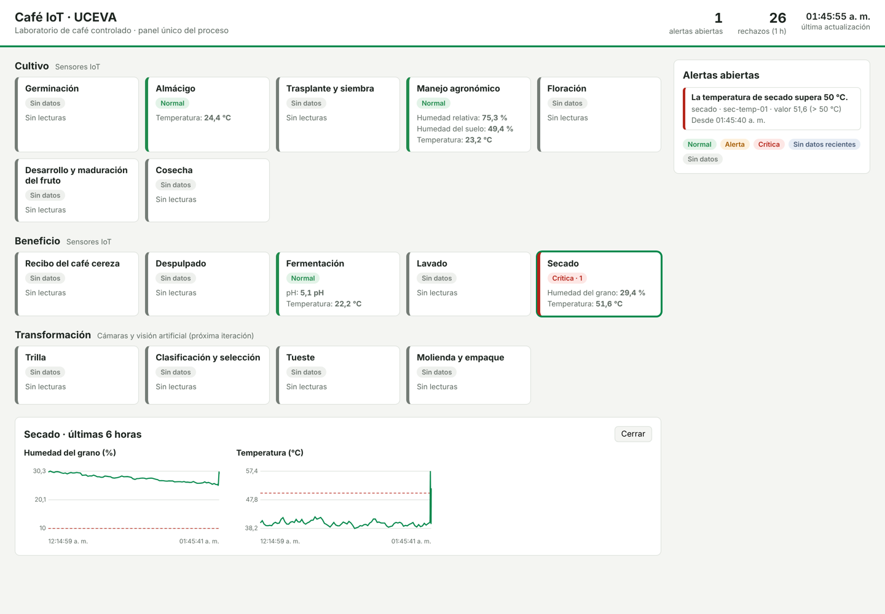

# Café IoT · UCEVA

Software para el monitoreo del proceso de elaboración del café mediante sensores IoT y visión artificial en el laboratorio de la UCEVA.

Trabajo de grado del programa de Ingeniería de Sistemas, Unidad Central del Valle del Cauca (UCEVA). Este repositorio contiene **solo la capa de software**; los sensores, las cámaras y los microcontroladores los construye el equipo de Ingeniería Electrónica.



*Panel del prototipo con datos del simulador. Los valores son inventados.*

## Qué hace

El sistema recibe los datos de los sensores y las cámaras del laboratorio de café controlado, los valida, los almacena, los procesa con reglas y visión artificial, genera alertas y las muestra en un panel único por etapa del proceso.

| Componente | Objetivo específico | Estado |
| --- | --- | --- |
| 1. Ingesta y validación | Objetivo 1 | Prototipo (iteración 1) |
| 2. Almacenamiento | Objetivo 1 | Prototipo (iteración 1) |
| 3. Procesamiento: motor de reglas | Objetivo 3 | Prototipo con reglas de ejemplo |
| 3. Procesamiento: visión artificial | Objetivo 3 | Por iniciar |
| 4. Alertas y detecciones | Objetivo 3 | Prototipo (iteración 1) |
| 5. Panel único | Objetivo 2 | Prototipo (iteración 1) |

Mientras llegan los sensores reales, un **simulador** publica lecturas inventadas con el mismo formato que deberán usar los dispositivos de Electrónica.

## Cómo correrlo

### Opción A: con Docker (recomendada)

Requiere [Docker Desktop](https://www.docker.com/products/docker-desktop/).

```bash
docker compose --profile simulador up --build
```

- Panel: <http://localhost:8000>
- Documentación de la API: <http://localhost:8000/docs>

Para detenerlo: `Ctrl+C` y luego `docker compose down`. Para borrar también los datos: `docker compose down -v`.

### Opción B: sin Docker

Requiere Python 3.11 o superior, PostgreSQL y Mosquitto instalados y corriendo.

```bash
python -m venv .venv
.venv\Scripts\activate          # Windows  (en Linux/Mac: source .venv/bin/activate)
pip install -e ".[dev]"

# En tres terminales distintas (con la variable DATABASE_URL apuntando a tu base de datos):
python -m cafe_iot.ingesta
uvicorn cafe_iot.api:app --port 8000
python simulador/simulador.py --historial 120 --invalidos
```

Opciones útiles del simulador:

| Opción | Qué hace |
| --- | --- |
| `--historial 120` | Envía primero 120 minutos de datos pasados, para tener gráficas. |
| `--anomalia` | La temperatura de secado sube sobre 50 °C y dispara una alerta. |
| `--invalidos` | Envía de vez en cuando mensajes mal formados, para ver los rechazos. |
| `--intervalo 5` | Segundos entre lecturas. |

### Pruebas

```bash
pytest
```

## Estructura

```
config/          etapas del proceso y reglas de alerta (YAML)
contrato/        esquema JSON del mensaje de los sensores
docs/            contrato de datos con Electrónica y decisiones técnicas
mosquitto/       configuración del servidor MQTT
simulador/       simulador de sensores
src/cafe_iot/    código: contrato, ingesta, base de datos, reglas, API y panel
tests/           pruebas automáticas
```

## Pendiente de confirmar

- La lista de las 16 etapas (`config/etapas.yaml`) es provisional hasta que la confirme el docente orientador.
- Salvo las dos reglas de secado, que citan su fuente, los umbrales de `config/reglas.yaml` son ejemplos; se deben definir con apoyo agronómico.
- El formato de datos ([docs/contrato_datos.md](docs/contrato_datos.md)) es una propuesta para acordar con Electrónica.
- Las tecnologías ([docs/decisiones.md](docs/decisiones.md)) están por aprobar con el director.

## Ramas

- `main`: solo lo aprobado por ambos integrantes.
- `develop`: integración de lo terminado.
- `feature/<nombre>`: trabajo en curso.

El flujo completo está en [CONTRIBUTING.md](CONTRIBUTING.md).
